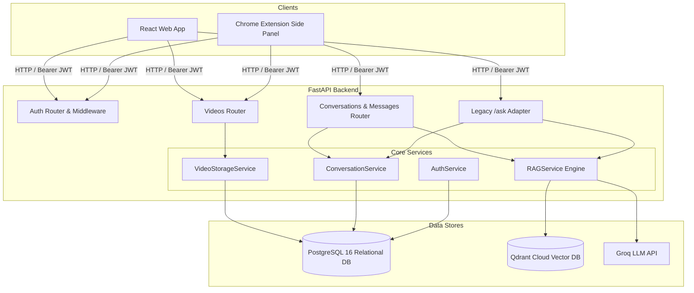
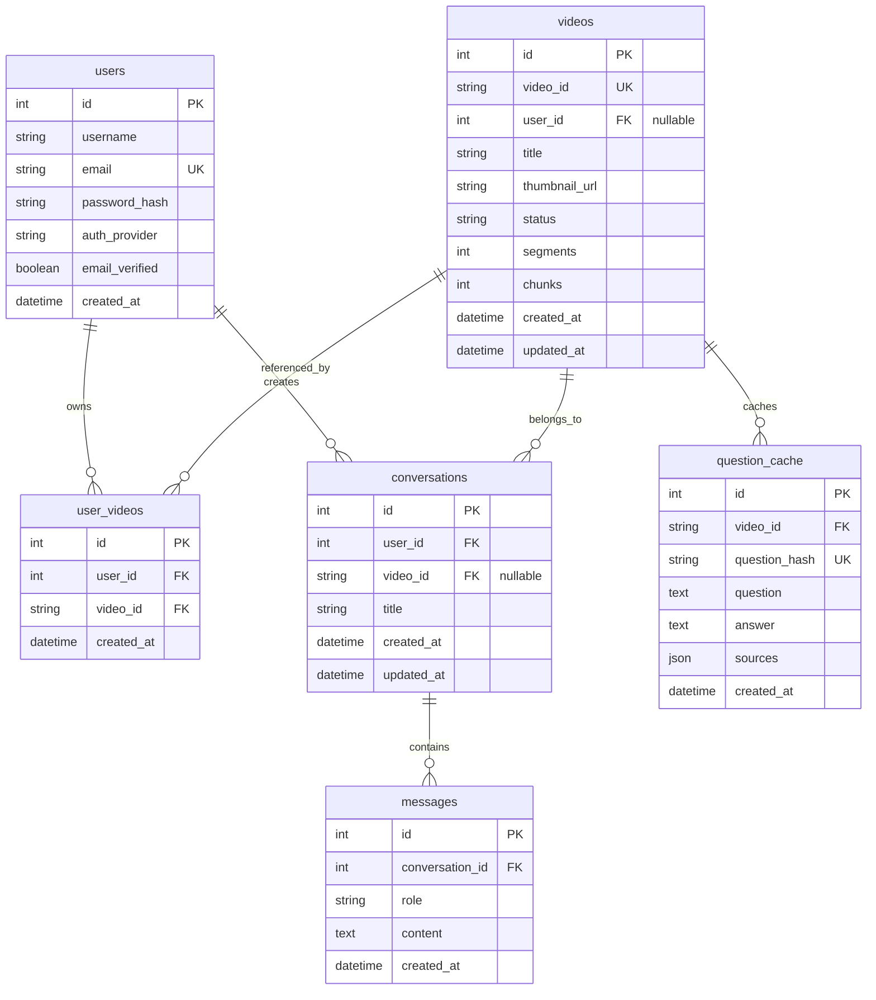

# VidMind 2.0 — Backend Architecture Specification

## 1. System Overview

VidMind is an AI-powered YouTube video question-answering system. In VidMind 2.0, the backend serves two distinct client interfaces over a unified RESTful API:
1. **Standalone React Web Application** (Vite + React)
2. **VidMind Chrome Extension** (Side panel operating alongside YouTube player)

---

## 2. Core Architectural Evolutions

### 2.1 Multi-User Canonical Video Deduplication (Defect 1 Resolved)
- **Problem**: In VidMind 1.0, `videos.video_id` was unique and tied to a single `user_id`. When User 2 attempted to process the same video, an `IntegrityError` occurred.
- **Solution**: Decoupled video existence from user ownership via the `user_videos` association table.
  - Canonical metadata (`Video`) stores title, thumbnail, processing status, transcript segment count, and vector chunk count once.
  - Association table `user_videos(user_id, video_id)` tracks which users have added the video to their personal library.
  - When User 2 submits an already-processed video, VidMind links User 2 immediately and returns `already_processed` without re-transcribing, re-embedding, or duplicating vectors in Qdrant.

### 2.2 Reference-Counted Safe Video Deletion (Defect 2 Resolved)
- **Problem**: In VidMind 1.0, when a user deleted a video, the backend immediately purged Qdrant vectors and cached answers, breaking retrieval for other users.
- **Solution**: Reference-counted deletion in `VideoStorageService.delete_video`:
  1. Unlinks the requesting user by deleting their `user_videos` entry.
  2. Inspects remaining references:
     - Other users in `user_videos` (`count > 0`).
     - Active conversations referencing `video_id` (`count > 0`).
  3. Only when reference count drops to **zero** are Qdrant vectors, cached answers, and canonical database rows permanently pruned.

### 2.3 Cross-Video Conversation Isolation (Defect 4 Resolved)
- **Problem**: In VidMind 1.0, conversations were not bound to video IDs. A user could submit a question about Video B within a thread created for Video A, causing context contamination.
- **Solution**: Added `conversations.video_id` foreign key.
  - When a conversation is created or queried, `video_id` is validated.
  - If a user sends a query for Video B inside a conversation bound to Video A, the API rejects it with `HTTP 400 Bad Request`.

### 2.4 Distributed Advisory Locking & Ingestion Concurrency (Defect 3 Resolved)
- **Problem**: Concurrent requests for the same YouTube URL across multiple server processes, background workers, or replicas could trigger duplicate transcription, chunking, and vector ingestion, resulting in wasted API quotas and vector store conflicts.
- **Solution**: Two-tier concurrency coordination:
  1. **Distributed PostgreSQL Advisory Locks**: `VideoIngestionLock` in [`app.services.lock_service`](file:///backend/app/services/lock_service.py) derives a signed 64-bit integer lock ID from the video ID using SHA-256 and executes non-blocking `pg_try_advisory_lock(lock_id)` on the database connection.
  2. Exactly one worker acquires the advisory lock and executes the ingestion pipeline (fetch transcript, chunk, embed, store vectors in Qdrant).
  3. Any concurrent request from another worker or thread immediately detects that processing is already underway, links the requesting user to the canonical record, and exits cleanly without duplicating work or requiring Redis.
  4. Releases cleanly in `finally` with transaction-safe error recovery, backed by a thread-safe mutex fallback for SQLite test suites.

### 2.5 Dual-Client Dynamic CORS & Chrome Extension Support (Defect 6 Resolved)
- **Problem**: Static CORS allowed only hardcoded localhost ports. Chrome extensions using `chrome-extension://<extension-id>` were blocked by browser preflight requests.
- **Solution**: Dynamic `all_cors_origins` computation combining Web URLs, environment-configured origins, and Chrome extension origins, supported by regex matching `^chrome-extension://[a-zA-Z0-9_-]+$`.

---

## 3. Database Schema

