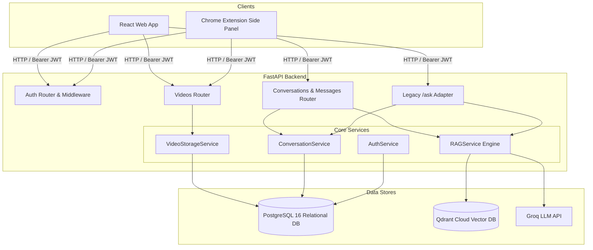
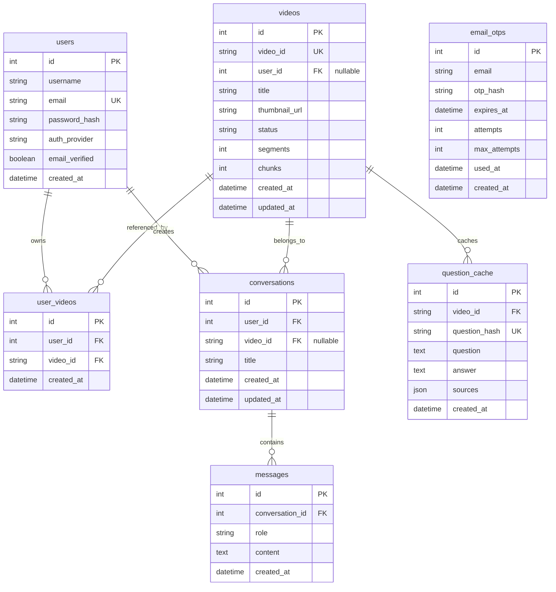

# YtGenius 2.0 — Backend Architecture Specification

## 1. System Overview

YtGenius is an AI-powered YouTube video question-answering system. In YtGenius 2.0, the backend provides a unified RESTful API designed to serve:
1. **Standalone React Web Application** (Vite + React) — *Primary active frontend implementation.*
2. **YtGenius Chrome Extension** (Side panel operating alongside YouTube player) — *Deferred client roadmap item; backend provides dynamic CORS (`chrome-extension://*`) and endpoint compatibility, but the extension package is not included in the current repository implementation.*



---

## 2. Core Architectural Evolutions

### 2.1 Multi-User Canonical Video Deduplication (Defect 1 Resolved)
- **Problem**: In VidMind 1.0, `videos.video_id` was unique and tied to a single `user_id`. When User 2 attempted to process the same video, an `IntegrityError` occurred.
- **Solution**: Decoupled video existence from user ownership via the `user_videos` association table.
  - Canonical metadata (`Video`) stores title, thumbnail, processing status, transcript segment count, and vector chunk count once.
  - Association table `user_videos(user_id, video_id)` tracks which users have added the video to their personal library.
  - When User 2 submits an already-processed video, YtGenius links User 2 immediately and returns `already_processed` without re-transcribing, re-embedding, or duplicating vectors in Qdrant.

### 2.2 Reference-Counted Safe Video Deletion (Defect 2 Resolved)
- **Problem**: In VidMind 1.0, when a user deleted a video, the backend immediately purged Qdrant vectors and cached answers, breaking retrieval for other users.
- **Solution**: Reference-counted deletion in `VideoStorageService.delete_video`:
  1. Unlinks the requesting user by deleting their `user_videos` entry.
  2. Inspects remaining references:
     - Other users in `user_videos` (`count > 0`).
     - Active conversations referencing `video_id` (`count > 0`).
  3. Only when reference count drops to **zero** are Qdrant vectors, cached answers, and canonical database rows permanently pruned.

### 2.3 Cross-Video Conversation Isolation (Defect 4 Resolved)
- **Problem**: In VidMind 1.0, conversations were not bound to video IDs. A user could submit a question about Video B within a thread created for Video A, causing context contamination.
- **Solution**: Added `conversations.video_id` foreign key.
  - When a conversation is created or queried, `video_id` is validated.
  - If a user sends a query for Video B inside a conversation bound to Video A, the API rejects it with `HTTP 400 Bad Request`.

### 2.4 Distributed Advisory Locking & Ingestion Concurrency (Defect 3 Resolved)
- **Problem**: Concurrent requests for the same YouTube URL across multiple server processes, background workers, or replicas could trigger duplicate transcription, chunking, and vector ingestion, resulting in wasted API quotas and vector store conflicts.
- **Solution**: Two-tier concurrency coordination:
  1. **Distributed PostgreSQL Advisory Locks**: `VideoIngestionLock` in [`app.services.lock_service`](file:///backend/app/services/lock_service.py) derives a signed 64-bit integer lock ID from the video ID using SHA-256 and executes non-blocking `pg_try_advisory_lock(lock_id)` on the database connection.
  2. Exactly one worker acquires the advisory lock and executes the ingestion pipeline (fetch transcript, chunk, embed, store vectors in Qdrant).
  3. Any concurrent request from another worker or thread immediately detects that processing is already underway, links the requesting user to the canonical record, and exits cleanly without duplicating work or requiring Redis.
  4. Releases cleanly in `finally` with transaction-safe error recovery, backed by a thread-safe mutex fallback for SQLite test suites.

### 2.5 Dual-Client Dynamic CORS & Chrome Extension Support (Defect 6 Resolved)
- **Problem**: Static CORS allowed only hardcoded localhost ports. Chrome extensions using `chrome-extension://<extension-id>` were blocked by browser preflight requests.
- **Solution**: Dynamic `all_cors_origins` computation combining Web URLs, environment-configured origins, and Chrome extension origins, supported by regex matching `^chrome-extension://[a-zA-Z0-9_-]+$`.

---

## 3. Database Schema



---

## 4. Containerization & Deployment Architecture

YtGenius 2.0 provides production-ready Docker containerization managed via Docker Compose (`docker-compose.yml`):

### 4.1 Multi-Stage Backend Dockerfile (`backend/Dockerfile`)
- **Stage 1 (Builder)**: Base image `python:3.12-slim`.
  - Installs compilation dependencies (`build-essential`, `libpq-dev`).
  - Filters out Windows-specific `pywin32==312` from `requirements.txt` (`grep -iv "^pywin32"`) so Linux wheels compile cleanly without modifying committed repository manifests.
  - Installs packages into `/root/.local`.
- **Stage 2 (Runner)**: Base image `python:3.12-slim`.
  - Installs runtime shared libraries: `libpq5` (PostgreSQL C client), `curl` (container health checks), and `libgomp1` (GNU OpenMP, required for PyTorch `torch` on Debian slim).
  - Creates dedicated system user `ytgenius` with explicit home `/home/ytgenius` (`useradd -r -g ytgenius -m -d /home/ytgenius -s /sbin/nologin ytgenius`).
  - Copies compiled wheels with ownership: `COPY --from=builder --chown=ytgenius:ytgenius /root/.local /home/ytgenius/.local`.
  - Configures non-root environment: `ENV HOME=/home/ytgenius PYTHONUSERBASE=/home/ytgenius/.local PATH="/home/ytgenius/.local/bin:$PATH"`.
  - Runs as `USER ytgenius`.
  - Automatic migration and web startup: `CMD ["sh", "-c", "alembic -c alembic.ini upgrade head && uvicorn app.main:app --host 0.0.0.0 --port 8000 --workers 4"]`.

### 4.2 Multi-Service Topology (`docker-compose.yml`)
- **`backend`**:
  - Exposes port `${PORT:-8000}:8000`.
  - Dynamic Google OAuth callback redirect URI tracking:
    ```yaml
    - GOOGLE_REDIRECT_URI=${GOOGLE_REDIRECT_URI:-http://localhost:${PORT:-8000}/auth/google/callback}
    ```
    Automatically aligns the callback port with `${PORT:-8000}`, while supporting explicit operator overrides via `GOOGLE_REDIRECT_URI`.
  - Enforces mandatory environment variables (`POSTGRES_PASSWORD`, `SECRET_KEY`, `FRONTEND_URL`) using fail-fast syntax.
  - Liveness probe: `curl -f http://localhost:8000/health/live`.
  - Startup dependencies:
    ```yaml
    depends_on:
      postgres:
        condition: service_healthy
      qdrant:
        condition: service_started
    ```
- **`postgres`**:
  - Image: `postgres:16-alpine`.
  - Ports: Bound strictly to loopback: `127.0.0.1:${POSTGRES_PORT:-5432}:5432`. Parameterized with `${POSTGRES_PORT:-5432}` to prevent host port conflicts when a native PostgreSQL service already occupies port 5432 on the host machine.
  - Volume: Named persistent volume `postgres_data:/var/lib/postgresql/data`.
  - Healthcheck: `pg_isready -U ${POSTGRES_USER:-ytgenius} -d ${POSTGRES_DB:-ytgenius}`.
- **`qdrant`**:
  - Image: `qdrant/qdrant:v1.13.2`.
  - Ports: Bound strictly to `127.0.0.1:6333:6333` and `127.0.0.1:6334:6334`.
  - Volume: Named persistent volume `qdrant_data:/qdrant/storage`.
  - Note: In managed cloud deployments, local `qdrant` service can be omitted and `QDRANT_URL` pointed to Qdrant Cloud.

### 4.3 Verification Status & Runtime Boundaries
- **Static Configuration Validation**: Passed cleanly via `docker-compose config --quiet` (exit code `0`).
- **Container Build & Runtime Verification**: Multi-stage Dockerfile successfully compiled, validating the non-root `ytgenius` user, Debian-slim runtime with `libgomp1`, Linux `pywin32` exclusion, and local Qdrant container startup.
- **OAuth Boundary Disclosure**: While OAuth configuration validation, token redirection logic, and state verification pass automated tests, **real Google OAuth end-to-end authentication using actual Google credentials has not been verified** against live Google accounts. Automated unit and integration tests are not equivalent to a real production OAuth login.
